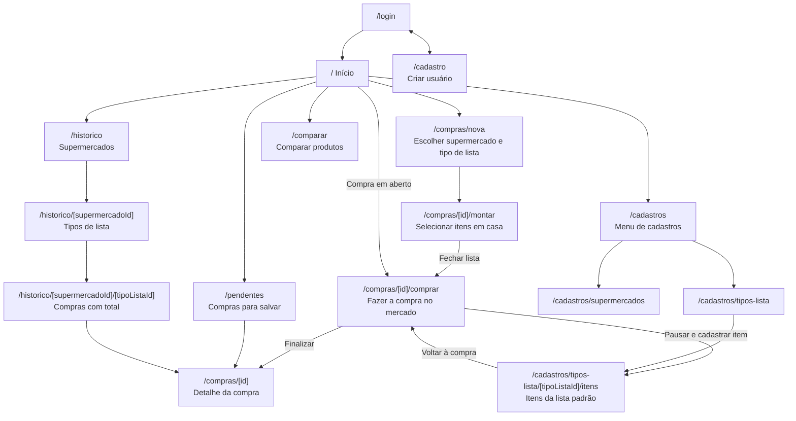

# Navegação de páginas — Lista de Compras

> Documento 1.2 do roteiro de desenvolvimento.
> Define as telas, as rotas e como o usuário se move entre elas. Os códigos RF e RN referem-se ao documento `01-requisitos.md`.

---

## 1. Princípios

- **Mobile-first:** as telas são pensadas primeiro para o celular, usado em pé no mercado, com poucos toques.
- **Barra de navegação inferior** com cinco atalhos: **Início**, **Nova compra**, **Histórico**, **Comparar** e **Cadastros**.
- **Painéis e diálogos em vez de telas extras:** editar um item, acrescentar um item e confirmar ações abrem como painel ou diálogo sobre a tela atual, sem trocar de rota.
- **Todas as rotas protegidas por login** (RF20). As únicas telas públicas são `/login` e `/cadastro`.
- **Nomes de rotas em português.**

---

## 2. Mapa de telas

---

## 3. Tabela de rotas

| Rota | Tela | O que mostra e o que permite | Requisitos |
|------|------|------------------------------|------------|
| `/login` | Login | Entrada no sistema. **Rota pública.** | RF20 |
| `/cadastro` | Cadastro de usuário | Informar nome e sobrenome para criar o usuário. O login é gerado como `nome.sobrenome` e, se já existir, o sistema pede um sobrenome diferente. **Rota pública.** | RF21, RN12 |
| `/` | Início | Atalhos para nova compra, **todas as compras em aberto** (cada uma com supermercado e tipo de lista), compras para salvar, histórico e comparação. Cada compra em aberto pode ser **excluída**. | RF06, RF07, RF18, RF22, RN10 |
| `/compras/nova` | Nova compra | Escolher o supermercado e depois o tipo de lista. | RF04 |
| `/compras/[id]/montar` | Montar lista | Selecionar os itens do tipo de lista, vendo último valor e valor médio no supermercado escolhido. Botão **Fechar lista**. | RF04, RF05, RF06 |
| `/compras/[id]/comprar` | Fazer compra | Itens pendentes, área de itens comprados, total, acrescentar item, pausar compra e finalizar. Ver seção 4. | RF07 a RF15 |
| `/compras/[id]` | Detalhe da compra | Itens com valor comprado e preço médio, total e supermercado. Botão **Salvar no banco** se a compra estiver finalizada e ainda não salva. Botão **Excluir compra**, com confirmação. | RF16, RF18, RF19, RF22 |
| `/pendentes` | Compras para salvar | Compras finalizadas que ainda não foram enviadas ao banco, com botão para salvar. | RF18 |
| `/historico` | Histórico — supermercados | Lista de supermercados que têm compras. | RF16 |
| `/historico/[supermercadoId]` | Histórico — tipos de lista | Tipos de lista com compras naquele supermercado. | RF16 |
| `/historico/[supermercadoId]/[tipoListaId]` | Histórico — compras | Compras feitas, cada uma com o valor total. | RF16 |
| `/comparar` | Comparar produtos | Produtos com o preço médio por unidade de medida em cada supermercado e o mais em conta destacado. | RF17 |
| `/cadastros` | Menu de cadastros | Acesso aos cadastros. | — |
| `/cadastros/supermercados` | Supermercados | Cadastrar, editar e excluir. Se já houver histórico, o supermercado é desativado em vez de apagado. | RF01, RN13 |
| `/cadastros/tipos-lista` | Tipos de lista | Cadastrar, editar e excluir. Se já houver histórico, o tipo é desativado em vez de apagado. | RF02, RN13 |
| `/cadastros/tipos-lista/[tipoListaId]/itens` | Itens da lista padrão | Cadastrar, editar e excluir itens (produto, quantidade, unidade, marca e observação). | RF03 |

**Regra de entrada pelo código da compra:** ao abrir `/compras/[id]`, o sistema leva o usuário para a tela certa conforme a situação da compra:

| Situação da compra | Tela aberta |
|--------------------|-------------|
| Em montagem | `/compras/[id]/montar` |
| Em aberto | `/compras/[id]/comprar` |
| Finalizada ou salva | `/compras/[id]` (detalhe) |

---

## 4. Tela "Fazer compra" (`/compras/[id]/comprar`)

É a tela mais importante do app, usada no mercado.

**Topo**
- Nome do supermercado e tipo de lista.
- **Total da compra**, atualizado a cada item comprado (RN04).
- Botão **Pausar compra** (RF09).

**Área de itens pendentes**
Cada item mostra:
- nome do produto, quantidade e unidade (editáveis, RF10);
- último valor e valor médio no supermercado;
- campo para informar o **preço**;
- botão **Comprar**, desativado enquanto não houver preço (RF11);
- indicação de preço **subiu** ou **desceu** ao informar o valor (RF14).

Ao tocar no item, abre um **painel de edição** com quantidade, unidade, embalagem, conteúdo, marca e observação. O painel também tem o botão **Excluir item** (RF10), para itens que não serão comprados.

**Botão Acrescentar item**
Abre um painel com os produtos cadastrados do tipo de lista que ainda não estão na compra (RF08). Se o produto desejado não existir, o usuário usa **Pausar compra**.

**Área de itens comprados** (no final da tela)
- Itens em aparência **esmaecida**, com o valor calculado (quantidade × valor unitário).
- Botão **Desfazer** em cada item, com **diálogo de confirmação** (RF13). Ao confirmar, o item volta para os pendentes e o valor sai do total.

**Rodapé**
- Botão **Finalizar compra** (RF15), **ativo somente quando todos os itens estiverem comprados**. Enquanto houver itens pendentes, o botão fica desativado e mostra quantos faltam.

---

## 5. Pausar a compra para cadastrar um item (RF09)

1. Na tela de compra, o usuário toca em **Pausar compra**.
2. O sistema leva à tela de itens do tipo de lista (`/cadastros/tipos-lista/[tipoListaId]/itens`), mostrando um aviso **"Compra em andamento"** com o botão **Voltar à compra**.
3. O usuário cadastra o item.
4. Ao tocar em **Voltar à compra**, retorna a `/compras/[id]/comprar`, e o novo item já aparece disponível em **Acrescentar item**.

A compra continua **em aberto** durante a pausa. Se o usuário sair do app, o **Início** mostra as compras em aberto para retomá-las.

---

## 6. Proteção das rotas (RF20, RNF03)

- **Todas as rotas** exigem sessão ativa, exceto `/login` e `/cadastro`.
- Sem sessão, qualquer tentativa de abrir uma rota leva a `/login`. Depois do login, o usuário volta para a página que tentou abrir.
- Um usuário logado que abre `/login` ou `/cadastro` é levado ao Início.
- As páginas protegidas não podem ser guardadas em cache de modo que apareçam para quem não está logado (por exemplo, ao usar o botão voltar do navegador depois de sair da conta).
- Os arquivos técnicos do PWA (manifest, ícones e service worker) precisam ser acessíveis para o navegador instalar o app, mas não contêm nenhum dado do usuário.
- A forma exata de manter a proteção com o app funcionando offline será definida no documento de arquitetura (1.4).

---

## 7. Decisões pendentes

As decisões sobre login, sessão, logout e sincronização estão no documento `04-arquitetura.md`.
