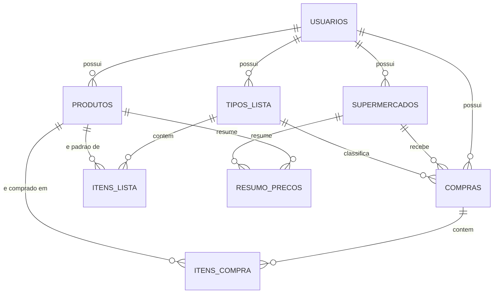

# Modelo de dados — Lista de Compras

> Documento 1.3 do roteiro de desenvolvimento.
> Define as tabelas, os campos, os cálculos de preço e o que acontece com os dados em cada ação do usuário. Os códigos RF e RN referem-se ao documento `01-requisitos.md`.

---

## 1. Visão geral

Os dados vivem em dois lugares:

- **Aparelho (IndexedDB, com Dexie):** é onde tudo acontece, inclusive sem internet. Guarda cadastros, compras em montagem, compras em aberto e o histórico.
- **Servidor (PostgreSQL):** recebe as compras finalizadas quando o usuário aperta **Salvar no banco** (RF18) e é a base das estatísticas.

As tabelas têm os mesmos nomes nos dois lugares. As diferenças estão na seção 7.

**Convenções**

- Nomes de tabelas e campos em **português**, em `snake_case` e sem acentos.
- Todo `id` é um **UUID gerado no aparelho**, inclusive o dos cadastros, porque o usuário cadastra offline (RN08).
- **Dinheiro** é guardado como **número inteiro em centavos** (R$ 9,00 = `900`), para evitar erros de arredondamento.
- Datas e horas em formato ISO (UTC).
- Toda tabela tem `criado_em` e `atualizado_em`.

---

## 2. Diagrama



`USUARIOS` existe só no servidor, e `RESUMO_PRECOS` só no aparelho (seção 7).

---

## 3. Enumerações

| Nome              | Valores                                  | Uso                                    |
| ----------------- | ---------------------------------------- | -------------------------------------- |
| `tipo_medida`     | `volume`, `peso`, `unidade`              | Define que unidades um produto aceita. |
| `unidade`         | `L`, `ml`, `kg`, `g`, `un`               | Unidade de medida do item.             |
| `unidade_base`    | `L`, `kg`, `un`                          | Unidade usada para comparar preços.    |
| `situacao_compra` | `em_montagem`, `em_aberto`, `finalizada` | Etapa da compra.                       |
| `situacao_item`   | `pendente`, `comprado`                   | Estado do item dentro da compra.       |

**Correspondência entre `tipo_medida` e `unidade`**

| `tipo_medida` | Unidades aceitas | `unidade_base` |
| ------------- | ---------------- | -------------- |
| `volume`      | `L`, `ml`        | `L`            |
| `peso`        | `kg`, `g`        | `kg`           |
| `unidade`     | `un`             | `un`           |

**Situação "salva":** não é um valor de `situacao_compra`. Uma compra está **salva** quando está `finalizada` e o campo `salva_em` está preenchido.

---

## 4. Tabelas

### 4.1 `supermercados` (RF01)

| Campo                        | Tipo      | Obrigatório | Descrição                                      |
| ---------------------------- | --------- | ----------- | ---------------------------------------------- |
| `id`                         | uuid      | sim         | Chave primária.                                |
| `nome`                       | texto     | sim         | Ex.: Assaí, Atacadão, Novo. Único por usuário. |
| `ativo`                      | booleano  | sim         | Padrão verdadeiro. Ver proposta P1.            |
| `criado_em`, `atualizado_em` | data/hora | sim         |                                                |

### 4.2 `tipos_lista` (RF02)

| Campo                        | Tipo      | Obrigatório | Descrição                                                                       |
| ---------------------------- | --------- | ----------- | ------------------------------------------------------------------------------- |
| `id`                         | uuid      | sim         | Chave primária.                                                                 |
| `nome`                       | texto     | sim         | Ex.: limpeza, alimentação. Único por usuário. Vale para todos os supermercados. |
| `ativo`                      | booleano  | sim         | Padrão verdadeiro. Ver proposta P1.                                             |
| `criado_em`, `atualizado_em` | data/hora | sim         |                                                                                 |

### 4.3 `produtos` (RN06)

| Campo                        | Tipo      | Obrigatório | Descrição                                                 |
| ---------------------------- | --------- | ----------- | --------------------------------------------------------- |
| `id`                         | uuid      | sim         | Chave primária.                                           |
| `nome`                       | texto     | sim         | Nome **genérico** (ex.: Desinfetante). Único por usuário. |
| `tipo_medida`                | enum      | sim         | `volume`, `peso` ou `unidade`.                            |
| `ativo`                      | booleano  | sim         | Padrão verdadeiro. Ver proposta P1.                       |
| `criado_em`, `atualizado_em` | data/hora | sim         |                                                           |

### 4.4 `itens_lista` (RF03) — o item padrão

| Campo                        | Tipo           | Obrigatório | Descrição                                           |
| ---------------------------- | -------------- | ----------- | --------------------------------------------------- |
| `id`                         | uuid           | sim         | Chave primária.                                     |
| `tipo_lista_id`              | uuid           | sim         | Referência a `tipos_lista`.                         |
| `produto_id`                 | uuid           | sim         | Referência a `produtos`.                            |
| `quantidade_padrao`          | decimal        | sim         | Maior que zero.                                     |
| `unidade_padrao`             | enum `unidade` | sim         | Deve ser compatível com o `tipo_medida` do produto. |
| `marca`                      | texto          | não         | Opcional (RN07).                                    |
| `observacao`                 | texto          | não         | Opcional (RN07).                                    |
| `criado_em`, `atualizado_em` | data/hora      | sim         |                                                     |

Único por (`tipo_lista_id`, `produto_id`).

### 4.5 `compras` (RF04 a RF15)

| Campo             | Tipo               | Obrigatório | Descrição                                                                                     |
| ----------------- | ------------------ | ----------- | --------------------------------------------------------------------------------------------- |
| `id`              | uuid               | sim         | Gerado no aparelho. É o que impede duplicidade no servidor (RN08).                            |
| `supermercado_id` | uuid               | sim         | Referência a `supermercados`.                                                                 |
| `tipo_lista_id`   | uuid               | sim         | Referência a `tipos_lista`.                                                                   |
| `situacao`        | enum               | sim         | `em_montagem`, `em_aberto` ou `finalizada`.                                                   |
| `valor_total`     | inteiro (centavos) | não         | Preenchido ao finalizar. Antes disso, o total é calculado na hora (soma dos itens comprados). |
| `criada_em`       | data/hora          | sim         | Quando a montagem começou.                                                                    |
| `fechada_em`      | data/hora          | não         | Quando a lista foi fechada (virou compra em aberto).                                          |
| `finalizada_em`   | data/hora          | não         | Quando a compra foi finalizada.                                                               |
| `salva_em`        | data/hora          | não         | Quando foi enviada ao banco. Vazio significa pendente de envio (RF18).                        |
| `atualizado_em`   | data/hora          | sim         |                                                                                               |

### 4.6 `itens_compra` (RF05 a RF14)

| Campo                        | Tipo               | Obrigatório   | Descrição                                                                                                      |
| ---------------------------- | ------------------ | ------------- | -------------------------------------------------------------------------------------------------------------- |
| `id`                         | uuid               | sim           | Chave primária.                                                                                                |
| `compra_id`                  | uuid               | sim           | Referência a `compras`.                                                                                        |
| `produto_id`                 | uuid               | sim           | Referência a `produtos`.                                                                                       |
| `situacao`                   | enum               | sim           | `pendente` ou `comprado`.                                                                                      |
| `quantidade`                 | decimal            | sim           | Quantas embalagens (ou quantos litros, quilos, unidades quando a unidade é "pura"). Maior que zero.            |
| `embalagem`                  | texto              | não           | Texto livre, ex.: galão, frasco, caixa. Só descritivo.                                                         |
| `conteudo`                   | decimal            | sim           | Quanto vem em **uma** embalagem, na `unidade`. Assume 1 quando a unidade é L, kg ou un "pura". Maior que zero. |
| `unidade`                    | enum `unidade`     | sim           | `L`, `ml`, `kg`, `g` ou `un`.                                                                                  |
| `marca`                      | texto              | não           | Informativa, não entra no cálculo (RN06).                                                                      |
| `observacao`                 | texto              | não           | Opcional.                                                                                                      |
| `valor_unitario`             | inteiro (centavos) | só ao comprar | Preço de **uma** embalagem, informado pelo usuário.                                                            |
| `valor_item`                 | inteiro (centavos) | não           | **Calculado** ao comprar: `quantidade × valor_unitario`.                                                       |
| `unidade_base`               | enum               | não           | **Calculado** ao comprar: `L`, `kg` ou `un`.                                                                   |
| `preco_unidade_base`         | decimal            | não           | **Calculado** ao comprar: preço de 1 litro, 1 quilo ou 1 unidade (em centavos).                                |
| `comprado_em`                | data/hora          | não           | Quando o botão Comprar foi acionado.                                                                           |
| `criado_em`, `atualizado_em` | data/hora          | sim           |                                                                                                                |

Único por (`compra_id`, `produto_id`): um produto aparece uma vez em cada compra.

### 4.7 `resumo_precos` (somente no aparelho)

É um **cache** que permite mostrar último valor e valor médio sem internet e sem recalcular o histórico inteiro. Pode ser reconstruído a qualquer momento a partir de `itens_compra`.

| Campo                | Tipo      | Descrição                                                  |
| -------------------- | --------- | ---------------------------------------------------------- |
| `produto_id`         | uuid      | Parte da chave primária.                                   |
| `supermercado_id`    | uuid      | Parte da chave primária.                                   |
| `unidade_base`       | enum      | `L`, `kg` ou `un`.                                         |
| `ultimo_valor`       | decimal   | `preco_unidade_base` da compra mais recente.               |
| `ultima_compra_em`   | data/hora | Data dessa compra.                                         |
| `soma_precos`        | decimal   | Soma de todos os `preco_unidade_base` registrados.         |
| `quantidade_compras` | inteiro   | Quantas vezes o produto foi comprado naquele supermercado. |

### 4.8 `usuarios` (somente no servidor)

| Campo                        | Tipo      | Obrigatório    | Descrição                                                                     |
| ---------------------------- | --------- | -------------- | ----------------------------------------------------------------------------- |
| `id`                         | uuid      | sim            | Chave primária.                                                               |
| `nome`                       | texto     | sim            | Primeiro nome informado no cadastro.                                          |
| `sobrenome`                  | texto     | sim            | Sobrenome informado no cadastro.                                              |
| `login`                      | texto     | sim            | `nome.sobrenome`, em minúsculas, sem acentos e sem espaços (RN12). **Único.** |
| `senha_hash`                 | texto     | em confirmação | Hash da senha, se a senha for aprovada (documento 04, seção 8.2).             |
| `criado_em`, `atualizado_em` | data/hora | sim            |                                                                               |

---

## 5. Cálculos

### 5.1 Conversão para a unidade base

| Unidade         | Fator para a unidade base |
| --------------- | ------------------------- |
| `L`, `kg`, `un` | 1                         |
| `ml`            | 0,001 (para litros)       |
| `g`             | 0,001 (para quilos)       |

### 5.2 Preço por unidade base (RN01)

```
preco_unidade_base = valor_unitario ÷ (conteudo × fator da unidade)
```

Exemplos:

- Galão de 5 L por R$ 9,00: `900 ÷ (5 × 1)` = **180 centavos por litro** (R$ 1,80/L).
- Frasco de 2 L por R$ 4,00: `400 ÷ (2 × 1)` = **200 centavos por litro** (R$ 2,00/L). O galão sai mais em conta.
- Frasco de 500 ml por R$ 3,00: `300 ÷ (500 × 0,001)` = **600 centavos por litro** (R$ 6,00/L).

### 5.3 Valor do item e total da compra (RN04)

```
valor_item   = quantidade × valor_unitario   (arredondado para centavos)
valor_total  = soma dos valor_item dos itens comprados
```

### 5.4 Último valor e valor médio (RN02)

Por **produto + supermercado**, considerando só itens comprados de compras **finalizadas**:

```
ultimo_valor = preco_unidade_base do item com comprado_em mais recente
valor_medio  = soma_precos ÷ quantidade_compras     (média simples)
```

Se não houver nenhuma compra do produto naquele supermercado, a tela mostra "sem histórico" (RF05).

### 5.5 Supermercado mais em conta (RN03)

Para cada produto, compara-se o `valor_medio` de cada supermercado dentro da mesma `unidade_base`. O **menor valor médio** é destacado (RF17).

---

## 6. O que acontece com os dados em cada ação

| Ação do usuário                       | Efeito nos dados                                                                                                                                                                                                               |
| ------------------------------------- | ------------------------------------------------------------------------------------------------------------------------------------------------------------------------------------------------------------------------------ |
| Escolher supermercado e tipo de lista | Cria a `compra` com `situacao = em_montagem`.                                                                                                                                                                                  |
| Selecionar um item em casa            | Cria um `item_compra` `pendente`, copiando do item padrão: quantidade, unidade, marca e observação, com `conteudo = 1`.                                                                                                        |
| Fechar a lista                        | `situacao = em_aberto` e `fechada_em` preenchida.                                                                                                                                                                              |
| Acrescentar item no mercado           | Cria um `item_compra` `pendente` a partir de um produto cadastrado (RF08).                                                                                                                                                     |
| Editar item na compra                 | Altera só o `item_compra`. O `item_lista` não muda (RN05).                                                                                                                                                                     |
| Excluir item da compra                | Remove o `item_compra`. Só itens `pendente` podem ser excluídos; um item comprado precisa ser desfeito antes (RF10).                                                                                                           |
| Comprar                               | `situacao = comprado`. Calcula `valor_item`, `unidade_base` e `preco_unidade_base`, e preenche `comprado_em`. O total da compra aumenta.                                                                                       |
| Desfazer item comprado                | Volta a `pendente`. Limpa `valor_item`, `unidade_base`, `preco_unidade_base` e `comprado_em`. Mantém o `valor_unitario` digitado para facilitar a correção. O total diminui.                                                   |
| Finalizar compra                      | Grava `valor_total`, `situacao = finalizada` e `finalizada_em`. Atualiza o `resumo_precos` de cada item comprado. O botão só fica ativo quando todos os itens estão comprados (RF15).                                          |
| Salvar no banco                       | Envia a compra, os itens comprados e os cadastros que eles usam. O servidor grava por `id` (sem duplicar). Ao confirmar, o aparelho preenche `salva_em`.                                                                       |
| Excluir compra                        | Em montagem ou em aberto: remove a compra e seus itens. Finalizada: remove a compra e seus itens, com confirmação. Se já estava salva, ela também sai do servidor, e o `resumo_precos` dos produtos dela é recalculado (RF22). |

---

## 7. Aparelho e servidor

| Assunto                              | Aparelho (Dexie)                                 | Servidor (PostgreSQL)                                                                                                     |
| ------------------------------------ | ------------------------------------------------ | ------------------------------------------------------------------------------------------------------------------------- |
| Tabelas de cadastro e compra         | Todas                                            | Todas, menos `resumo_precos`                                                                                              |
| `usuarios`                           | Não existe                                       | Existe. A sessão é um token (JWT), então o Auth.js não precisa de tabelas extras.                                         |
| `usuario_id`                         | Não existe: o banco local é separado por usuário | Existe em `supermercados`, `tipos_lista`, `produtos` e `compras`. As demais tabelas herdam o dono pela tabela-mãe (RN09). |
| Compras `em_montagem` e `em_aberto`  | Existem                                          | **Não existem**: só chegam compras finalizadas                                                                            |
| Itens `pendente`                     | Existem                                          | **Não existem**: ao finalizar, todos os itens da compra já estão comprados                                                |
| Dinheiro                             | Inteiro em centavos                              | Inteiro em centavos                                                                                                       |
| Quantidades e preço por unidade base | Número                                           | `decimal`                                                                                                                 |
| Estatísticas                         | Não                                              | Consultas SQL sobre `itens_compra` (RF19)                                                                                 |

**Envio ao servidor:** cada envio leva a compra, seus itens comprados e os cadastros referenciados (supermercado, tipo de lista e produtos). O servidor grava tudo com "inserir ou atualizar" pelo `id`. Repetir o envio é seguro.

---

## 8. Regras de integridade

- A `unidade` do item (e a `unidade_padrao` do item da lista) deve ser compatível com o `tipo_medida` do produto (tabela da seção 3).
- `quantidade`, `quantidade_padrao` e `conteudo` devem ser maiores que zero.
- O botão **Comprar** só funciona com `valor_unitario` maior que zero (RF11).
- Um produto aparece uma vez em cada compra.
- Uma compra só pode ser finalizada se tiver pelo menos um item e **todos os itens estiverem comprados** (RF15, RN11).
- Compra **finalizada** não tem itens, preços nem total editáveis.
- Todos os valores em dinheiro são inteiros em centavos.

---

## 9. Índices sugeridos

| Tabela          | Índice                                            | Para quê                                    |
| --------------- | ------------------------------------------------- | ------------------------------------------- |
| `compras`       | `situacao`                                        | Listar compras em aberto no Início.         |
| `compras`       | `supermercado_id` + `tipo_lista_id`               | Histórico por supermercado e tipo (RF16).   |
| `compras`       | `salva_em`                                        | Listar compras para salvar em `/pendentes`. |
| `itens_compra`  | `compra_id`                                       | Itens de uma compra.                        |
| `itens_compra`  | `produto_id` + `comprado_em`                      | Último valor e histórico de um produto.     |
| `resumo_precos` | `produto_id` + `supermercado_id` (chave primária) | Consulta imediata na montagem da lista.     |

---

## 10. Propostas aprovadas

| Código | Proposta                                                                                                                                                                                                                                                |
| ------ | ------------------------------------------------------------------------------------------------------------------------------------------------------------------------------------------------------------------------------------------------------- |
| P1     | **Cadastros com histórico não são apagados**: são **desativados** (`ativo = falso`) e somem das escolhas novas, mas o histórico continua intacto. Cadastros sem nenhuma compra podem ser excluídos de verdade.                                          |
| P2     | Compras **em montagem** ou **em aberto** podem ser **excluídas** sem rastro. Uma compra **finalizada** também pode ser excluída, com confirmação. Nesse caso ela sai do servidor (se já foi salva) e o `resumo_precos` dos produtos dela é recalculado. |

---

## 11. Decisões pendentes

As decisões sobre login, sessão, logout e sincronização estão no documento `04-arquitetura.md`.
