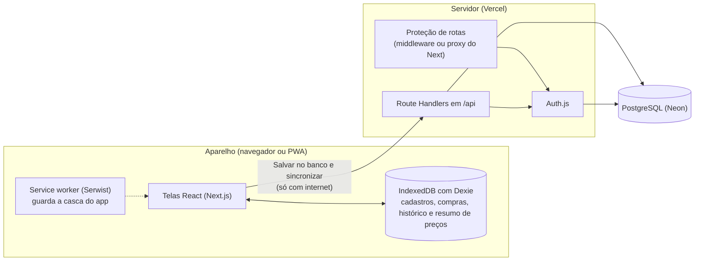

# Arquitetura — Lista de Compras

> Documento 1.4 do roteiro de desenvolvimento.
> Descreve como as peças do sistema se encaixam: funcionamento offline, login e proteção das páginas, e sincronização com o banco de dados. Os códigos RF, RN e RNF referem-se ao documento `01-requisitos.md`.

---

## 1. Visão geral

---

## 2. Princípios

1. **O aparelho faz o trabalho do dia a dia.** Montar a lista, comprar e consultar o histórico acontecem no IndexedDB, sem depender de internet (RNF01). O servidor é o arquivo das compras finalizadas e a base das estatísticas.
2. **As páginas não carregam dados pessoais.** O HTML que o servidor envia é apenas a "casca" da tela. Os dados vêm do IndexedDB (no aparelho) ou da API autenticada. Por isso, guardar a casca em cache para uso offline não expõe informação de ninguém.
3. **Proteção em camadas.** Servidor, API e aparelho verificam a sessão (seção 5).
4. **Envio seguro de repetir.** Cada compra tem um UUID, e o servidor grava pelo `id`, sem duplicar (RN08).
5. **Simplicidade.** Cada peça existe porque um requisito pede. Nada de tempo real, filas externas ou serviços a mais.

---

## 3. Stack

| Camada                  | Tecnologia                               | Função                                                                        |
| ----------------------- | ---------------------------------------- | ----------------------------------------------------------------------------- |
| Framework               | Next.js (App Router), React e TypeScript | Telas, rotas e API no mesmo projeto.                                          |
| Interface               | Tailwind CSS e shadcn/ui                 | Estilo e componentes acessíveis.                                              |
| Formulários e validação | React Hook Form e Zod                    | Formulários tipados. O mesmo esquema Zod valida a API.                        |
| Dados no aparelho       | Dexie (IndexedDB) e dexie-react-hooks    | Banco local com leitura reativa: a tela se atualiza quando o dado muda.       |
| Chamadas à API          | TanStack Query                           | Envio e sincronização, com tentativas e estado de carregamento. Uso moderado. |
| PWA                     | Serwist                                  | Service worker, cache da casca e instalação no celular.                       |
| Autenticação            | Auth.js                                  | Login por usuário (`nome.sobrenome`) e sessão por token (JWT).                |
| Banco no servidor       | PostgreSQL (Neon) e Prisma               | Compras salvas e estatísticas.                                                |
| API                     | Route Handlers do Next                   | Endpoints chamados pelo aparelho.                                             |
| Testes                  | Vitest e Testing Library                 | Cálculos e componentes.                                                       |
| Publicação              | Vercel                                   | Hospedagem do app.                                                            |

**Por que Route Handlers e não Server Actions:** o envio de compras pendentes é feito pelo código do aparelho, com tentativas e fila. Um endpoint HTTP comum é mais simples de chamar, repetir e testar nesse cenário.

---

## 4. Funcionamento offline (RNF01, RNF02)

### 4.1 Dados no aparelho

- Banco **Dexie** com as tabelas do documento 1.3.
- **Um banco por usuário**, com o nome `lista-de-compras-<id do usuário>`. Por isso as tabelas locais não precisam de `usuario_id` (RN09).
- Um pequeno banco separado, `lista-de-compras-sessao`, guarda o marcador de sessão (seção 5.2).
- Todas as telas leem e gravam direto no Dexie. Cálculos de preço e de último valor e média usam `resumo_precos`, também local.

### 4.2 Casca do app e service worker

- O service worker guarda arquivos de JavaScript, CSS, ícones e as páginas-casca.
- Com internet, as páginas são pedidas ao servidor, que aplica a proteção de rotas.
- Sem internet, o service worker entrega a casca guardada, e o app abre normalmente.
- Quando sai uma versão nova, o app aplica a atualização em segundo plano e avisa o usuário.

### 4.3 Instalação

- O app é um **PWA instalável**: manifest, ícones e service worker.
- Recomenda-se instalar na tela inicial do celular (importante para a seção 7).

### 4.4 Armazenamento persistente

- O app pede ao navegador armazenamento **persistente** (`navigator.storage.persist()`), para reduzir a chance de o navegador apagar os dados locais por falta de espaço.

---

## 5. Login e proteção das páginas (RF20, RF21, RNF03, RNF04)

### 5.1 Três camadas

| Camada             | Como protege                                                                                                                                                                     | Quando age         |
| ------------------ | -------------------------------------------------------------------------------------------------------------------------------------------------------------------------------- | ------------------ |
| Rotas no servidor  | O middleware (ou proxy, conforme a versão do Next) confere a sessão. Sem sessão, redireciona para `/login`. Só `/login`, `/cadastro` e os arquivos técnicos do PWA são públicos. | Com internet       |
| API                | Todo endpoint `/api` exige sessão e só devolve ou grava dados do usuário logado (RN09).                                                                                          | Com internet       |
| Guarda no aparelho | A casca consulta o marcador de sessão local. Sem marcador válido, leva a `/login` e não abre nenhum dado. O logout apaga o marcador.                                             | Com e sem internet |

**Limite desta proteção:** a guarda do aparelho impede o uso normal do app por quem não está logado, mas **não criptografa** o IndexedDB. Quem tiver o aparelho desbloqueado e conhecimento técnico pode ler os dados locais. Para um app pessoal isso é aceitável. Se um dia for necessário, dá para criptografar o banco local.

### 5.2 Marcador de sessão local

Guardado em `lista-de-compras-sessao`:

| Campo        | Descrição                                  |
| ------------ | ------------------------------------------ |
| `usuario_id` | Define qual banco local abrir.             |
| `nome`       | Para mostrar na tela.                      |
| `valido_ate` | Data até a qual o uso offline é permitido. |

- Criado depois de um **login com internet**.
- **Renovado** a cada acesso com internet.
- Sem internet, o app abre enquanto `valido_ate` não tiver passado.
- A validade é de **50 dias** (RNF04), o que cobre compras com mais de um mês de intervalo.

### 5.3 Fluxos

| Situação                                              | O que acontece                                                                                                                              |
| ----------------------------------------------------- | ------------------------------------------------------------------------------------------------------------------------------------------- |
| Primeiro acesso                                       | Abre `/login`. Quem ainda não tem usuário vai para `/cadastro`. Depois do login (com internet), cria sessão e marcador e vai para o Início. |
| Abrir o app com internet e sessão ativa               | Entra direto e renova a sessão e o marcador.                                                                                                |
| Abrir o app sem internet, marcador válido             | Entra normalmente e usa tudo offline.                                                                                                       |
| Abrir o app sem internet, marcador vencido ou ausente | Mostra a tela de login com o aviso "conecte-se à internet para entrar".                                                                     |
| Abrir uma página sem estar logado (com internet)      | O servidor redireciona para `/login`. Depois do login, volta à página pedida.                                                               |
| Voltar pelo botão do navegador depois de sair         | A casca consulta o marcador (apagado no logout) e leva a `/login`, sem mostrar dados.                                                       |
| Logout                                                | Encerra a sessão e apaga o marcador. Ver recomendação na seção 8.                                                                           |

### 5.4 Cadastro e login por nome.sobrenome (RF21, RN12)

1. Na tela `/cadastro`, o usuário informa **nome** e **sobrenome**.
2. O sistema monta o login: tudo em **minúsculas**, **sem acentos** e **sem espaços**, no formato `nome.sobrenome`.
3. Se o login já existir, o sistema avisa e pede um **sobrenome diferente** (por exemplo, com o segundo sobrenome).
4. Se estiver livre, cria o usuário e entra no sistema.

| Nome   | Sobrenome  | Login gerado     |
| ------ | ---------- | ---------------- |
| Rafael | Guedes     | `rafael.guedes`  |
| José   | Álvares    | `jose.alvares`   |
| João   | dos Santos | `joao.dossantos` |

O cadastro exige **internet**, porque a conferência do login acontece no servidor. A conferência final é feita no momento de gravar o usuário no banco, para evitar que duas pessoas criem o mesmo login ao mesmo tempo.

---

## 6. Sincronização com o banco (RF18, RF19)

### 6.1 Salvar no banco

1. A compra está **finalizada** e sem `salva_em`.
2. O app envia a compra, os itens comprados e os cadastros usados (`POST /api/compras`).
3. O servidor valida com Zod, confere o usuário e grava **tudo em uma transação**, usando o `id` (inserir ou atualizar).
4. O servidor responde com sucesso, e o aparelho preenche `salva_em`.

Repetir o envio não duplica nada.

### 6.2 Fila de compras para salvar

- Compras finalizadas sem `salva_em` aparecem em **`/pendentes`** e no Início.
- O app tenta enviar **ao abrir com internet** e **quando a conexão volta**. Há também o botão manual.
- O app não depende de sincronização em segundo plano do navegador, porque ela não existe em todos os aparelhos.

### 6.3 Endpoints

| Endpoint                   | Função                                                                                 |
| -------------------------- | -------------------------------------------------------------------------------------- |
| `POST /api/compras`        | Recebe uma compra finalizada com itens e cadastros usados. Grava de forma idempotente. |
| `/api/auth/*`              | Rotas do Auth.js: login, logout e sessão.                                              |
| `POST /api/cadastro`       | Cria um usuário novo. Recusa se o login já existir.                                    |
| `GET /api/sincronizacao`   | Devolve cadastros e histórico do usuário. Usado ao entrar em um aparelho novo.         |
| `DELETE /api/compras/[id]` | Exclui uma compra já salva (regra P2 do documento 1.3, RF22).                          |

### 6.4 Aparelho novo

1. Login com internet.
2. O app chama `GET /api/sincronizacao` e grava tudo no Dexie.
3. O app **reconstrói o `resumo_precos`** a partir dos itens comprados.

**Limitação:** compras **em montagem** e **em aberto** não vão ao servidor. Elas existem só no aparelho onde foram criadas.

### 6.5 Conflitos

- **Compras:** não conflitam. Cada uma nasce em um aparelho e, depois de finalizada, não muda.
- **Cadastros editados em dois aparelhos:** vale a alteração com `atualizado_em` mais recente.

---

## 7. Riscos e cuidados

| Risco                                                                                                                                                                    | Cuidado                                                                                                                           |
| ------------------------------------------------------------------------------------------------------------------------------------------------------------------------ | --------------------------------------------------------------------------------------------------------------------------------- |
| Alguns navegadores (principalmente o Safari no iPhone) podem apagar os dados de sites que ficam muitos dias sem uso, a menos que o app esteja instalado na tela inicial. | Instalar o PWA, pedir armazenamento persistente e salvar as compras no banco com frequência, pois o banco é a cópia de segurança. |
| Perder ou trocar de aparelho com compras em aberto.                                                                                                                      | Só compras salvas no banco são recuperadas. É uma limitação conhecida e aceita (seção 6.4).                                       |
| Dados locais sem criptografia.                                                                                                                                           | Aceitável para uso pessoal (seção 5.1).                                                                                           |
| Versão antiga do app guardada no cache.                                                                                                                                  | O app atualiza em segundo plano e avisa quando há versão nova.                                                                    |
| Dois envios ao mesmo tempo da mesma compra.                                                                                                                              | O servidor grava por `id` dentro de uma transação, então o resultado é o mesmo.                                                   |

---

## 8. Decisões

### 8.1 Decididas

| Assunto                 | Decisão                                                                                                                                                                                                              |
| ----------------------- | -------------------------------------------------------------------------------------------------------------------------------------------------------------------------------------------------------------------- |
| Usuário e login         | O login é **nome.sobrenome**, tudo em minúsculas (ex.: `rafael.guedes`). Se já existir, o sistema pede um sobrenome diferente (RN12). O sistema é para uso pessoal: o dono e, no máximo, um parente próximo (RNF07). |
| Duração da sessão       | **50 dias**, renovada a cada acesso com internet. O marcador local segue a mesma validade.                                                                                                                           |
| Logout                  | Encerra a sessão e **mantém os dados locais**, que continuam protegidos pelo login. A opção "Sair e apagar dados deste aparelho" avisa quando houver compras ainda não salvas.                                       |
| Cópia dos cadastros     | **Sim.** Supermercados, tipos de lista, produtos e itens padrão são enviados ao servidor junto com cada "Salvar no banco".                                                                                           |
| Aparelho novo           | **Sim.** Ao entrar com internet em um aparelho sem dados, o app baixa cadastros e histórico.                                                                                                                         |
| ORM                     | **Prisma.**                                                                                                                                                                                                          |
| Banco                   | **Neon** (PostgreSQL), plano gratuito.                                                                                                                                                                               |
| Regras do documento 1.3 | Cadastros com histórico são desativados (P1) e compras podem ser excluídas (P2).                                                                                                                                     |

### 8.2 Decididas

| Assunto                | Decisão                                                                                                                                                                                  |
| ---------------------- | ---------------------------------------------------------------------------------------------------------------------------------------------------------------------------------------- |
| Senha                  | Além do login `nome.sobrenome`, o usuário informa uma **senha** de **no mínimo 8 caracteres**, contendo **ao menos uma letra e ao menos um número**. Guardada no banco apenas como hash. |
| Confirmação de senha   | A tela de cadastro pede a senha **duas vezes**. As duas precisam ser iguais.                                                                                                             |
| Quem pode se cadastrar | A tela `/cadastro` é pública, mas exige um **código de convite** conferido no servidor. O código vem de variável de ambiente (`CODIGO_CONVITE`) e nunca é enviado ao cliente.            |

---

## 9. Próximos passos

- **Fase 2:** criação do projeto Next.js e configuração das ferramentas.
